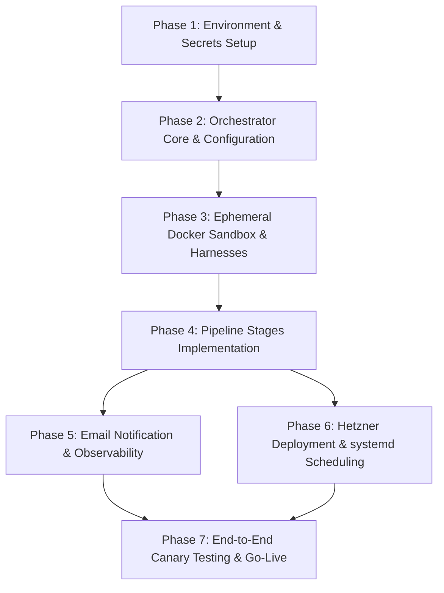

# Autonomous GitHub Maintenance & Development Agent: Architecture Design & Implementation Plan

---

## Part 1: Architecture Design & Decisions Record

### 1.1 Overview & Objective

The objective of this system is an autonomous, reliable, and secure weekly maintenance agent designed to run every Monday. The agent iterates over a configured list of GitHub repositories, handling routine maintenance, pull request reviews, automated merging, issue implementation, and proactive codebase ideation:

```mermaid
flowchart LR
    A["Monday 04:00 UTC<br/>(systemd.timer)"] --> B["Python Orchestrator<br/>(Hetzner VPS)"]
    B --> C["Authenticate as<br/>GitHub App"]
    C --> D["Iterate Configured Repos<br/>(config.yaml)"]
    D --> E["Phase 1: PR Comments Fix"]
    E --> F["Phase 2: PR Merge & Conflicts"]
    F --> G["Phase 3: Pick 'ready' Issues"]
    G --> H["Phase 4: Review & Ideation"]
    H --> I["Email Run Summary<br/>(Gmail SMTP)"]
```



---

### 1.2 Decision Log & Architectural Decisions

Every major design decision was evaluated and resolved during the `/grill-me` design interview. The table below records the context, chosen approach, alternatives rejected, and rationale.

| # | Topic | Decision Made | Alternatives Evaluated | Key Rationale |
|---|---|---|---|---|
| **1** | **Hosting & Scheduler** | **Dedicated Hetzner VPS** scheduled via Linux `systemd.timer` / cron on Mondays. | GitHub Actions (serverless cron), Hybrid event-driven webhook server. | Bypasses GitHub Actions 6-hour execution limits and runner pricing; centralizes credentials, caches Docker images, and supports persistent or headless agent CLI execution. |
| **2** | **Orchestrator Stack** | **Python-based orchestrator** managing git checkouts, GitHub API interactions, and container lifecycles. | Pure Bash/Make script, fully custom LangGraph/CrewAI agent framework. | Balances agility, strong typing, robust error handling, and separation of concerns. The orchestrator handles control flow while delegating code edits to specialized coding CLIs. |
| **3** | **Agent Coding Engines** | **Pluggable Agent Harness** with primary first-class support for **`agy` (Antigravity CLI / SDK)**, plus support for **`opencode` CLI** (backed by DeepSeek account & credits) and other OpenAI-compatible harnesses. | Single hardcoded CLI (e.g. Claude Code only, Aider only). | Allows selecting the best model and CLI per repository or task. Leverages existing Antigravity tooling while utilizing DeepSeek credits via OpenCode. |
| **4** | **Execution Isolation** | **Ephemeral Docker containers** per task execution. | Direct execution on host VM, persistent container per repo. | Shields the Hetzner host OS from untrusted code, arbitrary shell commands, and language dependency collisions (e.g., Node vs Python vs Rust versions). |
| **5** | **GitHub Identity & Auth** | **GitHub App** installed on target repositories/organizations. | Personal Access Token (PAT), dedicated machine user account. | Provides a distinct `app[bot]` identity, fine-grained least-privilege permissions (contents, issues, PRs, checks), eliminates token expiration, and signs verified commits. |
| **6** | **PR Comments Scope** | **Agent-managed PRs or explicitly opted-in PRs** (labeled `agent-fix` or mentioning bot). | All open PRs across all authors, bot-created PRs only. | Prevents uninvited commits or overwrites on human colleagues' in-progress PRs while allowing humans to explicitly delegate review fixes via label. |
| **7** | **PR Merge Guardrails** | **Strict verification**: PR must have `APPROVED` review, passing CI checks, and passing local tests after automated conflict resolution. | Permissive merge on `APPROVED` only, delegating auto-merge purely to GitHub branch rules. | Protects `main`/`master` branches against broken builds, regressions, or unresolved reviewer threads. |
| **8** | **Issue Implementation** | **1–2 issues per repo per run** labeled `ready` or `ready to implement`. Status tracked via `in-progress`. | Unlimited issues, single issue without local test gate. | Prevents PR review cascades and API exhaustion. Swapping labels prevents duplicate pickups. Failed test runs flag `agent-blocked` with diagnostic comments. |
| **9** | **Review & Ideation** | **Broad ideation (1–3 issues per run)** covering tech debt, missing tests, and novel feature ideas. Tagged `agent-proposal`. | 1 issue strict tech-debt only, security-only vulnerability scanning. | Fosters active repository development and creative improvements while utilizing semantic deduplication against past 90-day issues to prevent spam. |
| **10** | **Configuration Strategy** | **Central `config.yaml`** on Hetzner VPS + optional **`.github/agent.yaml`** in individual repositories for local overrides. | Organization-wide auto-discovery via topics, flat text file. | Centralizes management of all repositories, default branches, and test commands in one place, while allowing repo owners to override specific settings locally. |
| **11** | **Alerting & Notifications** | **Email notifications via Gmail SMTP** using a dedicated Google App Password. | Discord/Slack webhooks, GitHub meta-issues, local files only. | Direct delivery of formatted executive summaries to your personal inbox without relying on third-party chat webhooks or paid notification SaaS. |

---

### 1.3 Detailed System Architecture

#### A. Component Hierarchy

```
┌────────────────────────────────────────────────────────────────────────┐
│                          HETZNER VPS HOST                              │
│                                                                        │
│   ┌─────────────────────┐          ┌───────────────────────────────┐   │
│   │   systemd.timer     │ ───────> │  Python Orchestrator Core     │   │
│   │ (Mon 04:00:00 UTC)  │          │  (CLI: python -m src.main)    │   │
│   └─────────────────────┘          └───────────────┬───────────────┘   │
│                                                    │                   │
│         ┌──────────────────────────────────────────┼──────────────┐    │
│         │                                          │              │    │
│         ▼                                          ▼              ▼    │
│   ┌───────────┐                             ┌─────────────┐ ┌────────┐ │
│   │  config   │                             │ GitHub App  │ │ Gmail  │ │
│   │  .yaml    │                             │ Auth Client │ │ SMTP   │ │
│   └───────────┘                             └─────────────┘ └────────┘ │
│                                                    │                   │
│   ┌────────────────────────────────────────────────┴───────────────┐   │
│   │  Pipeline Runner (per repository)                              │   │
│   │                                                                │   │
│   │   Phase 1: PR Review Comments Resolver                         │   │
│   │   Phase 2: PR Merge & Conflict Resolver                        │   │
│   │   Phase 3: Issue Picker & Feature Implementer                  │   │
│   │   Phase 4: Code Reviewer & Ideation Engine                     │   │
│   └────────────────────────────────┬───────────────────────────────┘   │
│                                    │ Spawns task containers            │
│                                    ▼                                   │
│   ┌────────────────────────────────────────────────────────────┐       │
│   │          EPHEMERAL DOCKER CONTAINER SANDBOX                │       │
│   │                                                            │       │
│   │  Mounted: /workspace (cloned repo branch)                  │       │
│   │  Environment: Runtimes (Python, Node, Rust, etc.)          │       │
│   │                                                            │       │
│   │  ┌──────────────────────────────────────────────────────┐  │       │
│   │  │ Agent Harness (Antigravity 'agy' or OpenCode)        │  │       │
│   │  │  - Parses task prompt & context                      │  │       │
│   │  │  - Edits code files & runs build / test commands     │  │       │
│   │  │  - Validates git diff and test pass status           │  │       │
│   │  └──────────────────────────────────────────────────────┘  │       │
│   └────────────────────────────────────────────────────────────┘       │
└────────────────────────────────────────────────────────────────────────┘
```

#### B. Repository Processing Pipeline Flowchart

```mermaid
sequenceDiagram
    autonumber
    actor Scheduler as systemd / cron
    participant Orch as Python Orchestrator
    participant GH as GitHub REST / GraphQL
    participant Docker as Docker Sandbox
    participant Agent as Agent Harness (agy / opencode)
    participant SMTP as Gmail SMTP

    Scheduler->>Orch: Start weekly run (--all)
    Orch->>GH: Authenticate via GitHub App JWT -> Installation Token

    loop For each Repo in config.yaml
        critical Phase 1: PR Comments
            Orch->>GH: Fetch open PRs (bot-authored or 'agent-fix')
            Orch->>GH: Query unresolved review threads via GraphQL
            opt Unresolved comments found
                Orch->>Docker: Launch container with PR branch
                Docker->>Agent: Prompt: Resolve review feedback & run tests
                Agent-->>Docker: Files updated, tests passing
                Docker-->>Orch: Push commit to PR branch
                Orch->>GH: Post comment & resolve review threads
            end
        end

        critical Phase 2: PR Merge & Conflicts
            Orch->>GH: Fetch PRs with reviewDecision == APPROVED
            loop Each Approved PR
                alt Has merge conflicts
                    Orch->>Docker: Checkout PR branch, merge origin/main
                    Docker->>Agent: Resolve conflict markers & test
                    Docker-->>Orch: Conflict resolved commit
                    Orch->>GH: Push updated PR branch
                end
                Orch->>GH: Verify all CI checks pass
                opt CI is Green & zero pending threads
                    Orch->>GH: Execute Squash/Rebase Merge into main
                end
            end
        end

        critical Phase 3: Issue Implementation
            Orch->>GH: Fetch issues labeled 'ready' / 'ready to implement' (limit 2)
            loop Each Issue
                Orch->>GH: Swap label 'ready' -> 'in-progress', assign bot
                Orch->>Docker: Clone main, branch 'agent/issue-<id>-slug'
                Docker->>Agent: Implement issue description & comments; run tests
                alt Tests pass
                    Docker-->>Orch: Commit changes
                    Orch->>GH: Push branch, open PR 'Closes #<id>', label 'ready-for-review'
                else Tests fail or timeout
                    Orch->>GH: Post diagnostic failure log, label 'agent-blocked'
                end
            end
        end

        critical Phase 4: Review & Ideation
            Orch->>Docker: Inspect codebase, structure & recent changes
            Docker->>Agent: Generate 1-3 improvements (health + novel ideas)
            Orch->>GH: Fetch 90-day open/closed issues (deduplication)
            loop For each unique idea
                Orch->>GH: Create issue with rationale & label 'agent-proposal'
            end
        end
    end

    Orch->>SMTP: Dispatch Markdown/HTML Run Digest to Gmail
```

---

### 1.4 Detailed Component Specifications

#### A. GitHub App Permissions
The GitHub App requires the following permissions:
- **Repository Contents**: Read & Write (clone, branch, push, merge).
- **Issues**: Read & Write (list, label swap, comment, create proposals).
- **Pull Requests**: Read & Write (read comments, push commits, resolve threads, merge).
- **Checks / Commit Statuses**: Read (inspect CI pass/fail status).
- **Members / Metadata**: Read (inspect user mentions and bot assignments).

#### B. GraphQL Review Thread Resolution
GitHub line-level review comments cannot be resolved via the REST API. The orchestrator uses the GraphQL mutation:
```graphql
mutation ResolveThread($threadId: ID!) {
  resolveReviewThread(input: { threadId: $threadId }) {
    thread {
      id
      isResolved
    }
  }
}
```

#### C. Pluggable Harness Interface
The orchestrator dynamically routes tasks through `AgentHarness`:
```python
class AgentHarness(ABC):
    @abstractmethod
    def execute(
        self,
        workspace_dir: Path,
        prompt: str,
        test_command: str | None = None,
        timeout: int = 1800,
    ) -> HarnessResult:
        """
        Executes an agent task inside the target workspace.
        Returns a HarnessResult containing status, diff summary, and test output.
        """
        pass
```

- **`AntigravityHarness`**:
  Executes `agy` non-interactively with prompt arguments, tool permissions, and model parameters.
- **`OpenCodeHarness`**:
  Executes `opencode run "<prompt>"` configuring DeepSeek API key and base URL in environment variables.

#### D. Email Summary Structure (Gmail SMTP)
The weekly digest contains:
- **Header**: Execution timestamp, total duration, repos evaluated.
- **Summary Matrix**: Table listing Repos, PRs Fixed, PRs Merged, PRs Created, Issues Filed, Blocked Issues.
- **Detailed Action Logs**: Collapsible sections per repo with PR numbers, commit hashes, and failure diagnostics.

---

## Part 2: Implementation Tasks & Roadmap

The implementation is broken down into structured, sequential phases.



---

### Phase 1: Environment, Credentials & Security Setup
- [ ] **Task 1.1: GitHub App Creation**
  - Register a new GitHub App (e.g. `Weekly-Repo-Agent`) under your account or organization.
  - Set permissions: Contents (R/W), Issues (R/W), Pull Requests (R/W), Checks (Read).
  - Generate and download the RSA Private Key (`github-app.private-key.pem`).
  - Install the App on the target maintenance repositories.
  - Note the `App ID` and `Installation ID`.
- [ ] **Task 1.2: Gmail SMTP Setup**
  - Enable 2-Step Verification on the designated Google Account.
  - Generate an **App Password** named `GitHub Repo Agent`.
  - Record the 16-character password for `.env`.
- [ ] **Task 1.3: DeepSeek & LLM API Credentials**
  - Retrieve `DEEPSEEK_API_KEY` from DeepSeek platform.
  - Ensure Antigravity CLI / SDK authentication credentials (`~/.gemini/` or auth tokens) are ready for mounting.

---

### Phase 2: Orchestrator Core & Configuration Management
- [ ] **Task 2.1: Project Repository Scaffolding**
  - Set up Python project with `pyproject.toml` (dependencies: `PyGithub`, `httpx`, `pyyaml`, `pydantic`, `docker`, `jinja2`).
  - Establish directory structure:
    ```
    src/
    ├── config.py
    ├── github/
    │   ├── auth.py
    │   └── client.py
    ├── harnesses/
    │   ├── base.py
    │   ├── antigravity.py
    │   └── opencode.py
    ├── sandbox/
    │   └── container.py
    ├── pipeline/
    │   ├── stage1_comments.py
    │   ├── stage2_merger.py
    │   ├── stage3_issues.py
    │   └── stage4_ideation.py
    ├── reporting/
    │   └── email_digest.py
    └── main.py
    ```
- [ ] **Task 2.2: Configuration Schema (`config.py`)**
  - Define Pydantic models for `config.yaml` validating repos, branches, test/lint commands, harness assignments, and thresholds.
  - Support local `.github/agent.yaml` repository overrides.
- [ ] **Task 2.3: GitHub App Authenticator (`github/auth.py`)**
  - Implement JWT generation from RSA Private Key.
  - Implement automatic exchange of JWT for short-lived Installation Access Tokens (with caching and automatic renewal).
  - Implement GraphQL helper with error-handling and retry logic.

---

### Phase 3: Ephemeral Docker Sandbox & Pluggable Harnesses
- [ ] **Task 3.1: Docker Sandbox Image (`Dockerfile.sandbox`)**
  - Base image with Git, Python 3.11+, Node.js (LTS), Go/Rust (if needed).
  - Install `agy` (Antigravity CLI / SDK) and `opencode` CLI globally.
  - Add non-root runner user with safe permissions.
- [ ] **Task 3.2: Docker Container Controller (`sandbox/container.py`)**
  - Implement Python Docker SDK wrapper to spawn containers per task.
  - Mount git workspace read/write, pass required environment variables (`DEEPSEEK_API_KEY`, etc.).
  - Set hard memory, CPU, and execution timeout limits (e.g. 30 minutes max).
- [ ] **Task 3.3: Harness Implementation (`harnesses/`)**
  - Implement `AgentHarness` abstract base class.
  - Implement `AntigravityHarness`: passes prompts to `agy`, runs build/test loops.
  - Implement `OpenCodeHarness`: configures model and API keys for `opencode run`.
  - Add unit tests verifying harness argument passing and exit-code parsing.

---

### Phase 4: Pipeline Stages Implementation
- [ ] **Task 4.1: Phase 1 — PR Review Comment Resolver (`pipeline/stage1_comments.py`)**
  - Query open PRs filtered by author (`app[bot]`) or label `agent-fix`.
  - Query GraphQL for unresolved review threads.
  - Checkout PR branch in sandbox, prompt harness with diff & comment text.
  - Run repo test command inside sandbox.
  - On pass: push commit, post reply comment, call `resolveReviewThread` GraphQL mutation.
- [ ] **Task 4.2: Phase 2 — PR Auto-Merge & Conflicts (`pipeline/stage2_merger.py`)**
  - Filter PRs with review status `APPROVED` and no unresolved review threads.
  - Check CI check runs (`statusCheckRollup`); abort merge if any check failed.
  - If merge conflict exists:
    - Attempt automated rebase/merge of `main` into PR branch inside sandbox.
    - Prompt harness to resolve conflict markers, run test suite.
    - If green, push branch update.
  - Execute squash or rebase merge via GitHub API once all conditions pass.
- [ ] **Task 4.3: Phase 3 — Issue Implementation Worker (`pipeline/stage3_issues.py`)**
  - Scan open issues for labels `ready` or `ready to implement`.
  - Apply max issue limit (1–2 per repo).
  - Swap label `ready` -> `in-progress` and assign bot.
  - Checkout fresh branch `agent/issue-<id>-<slug>` from `main`.
  - Dispatch harness to implement issue description + comments.
  - Run repo test suite inside sandbox.
  - If pass: push branch, create PR with body referencing `Closes #<id>`, label issue `ready-for-review`.
  - If fail: revert branch, post failure comment on issue, label issue `agent-blocked`.
- [ ] **Task 4.4: Phase 4 — Code Review & Ideation Engine (`pipeline/stage4_ideation.py`)**
  - Extract repo directory structure, dependencies, README, and recent git history.
  - Query open and closed issues from past 90 days for deduplication.
  - Prompt model to identify 1–3 concrete ideas (tech debt, test gaps, feature ideas).
  - Filter out ideas that overlap semantically with existing issues.
  - Create GitHub issues with label `agent-proposal`.

---

### Phase 5: Notification Service & Observability
- [ ] **Task 5.1: Jinja2 Email Digest Template (`reporting/template.html`)**
  - Design clean, mobile-responsive HTML summary.
  - Include summary metrics table: Repos processed, PRs merged, PRs opened, issues filed, errors.
  - Include detailed breakdown with links to PRs and issues.
- [ ] **Task 5.2: Gmail SMTP Dispatcher (`reporting/email_digest.py`)**
  - Implement TLS connection to `smtp.gmail.com:587`.
  - Authenticate using Gmail address and 16-character Google App Password.
  - Dispatch multipart HTML/text email on pipeline completion or failure.
- [ ] **Task 5.3: Structured Logging & Rotation**
  - Implement Python `logging` with JSON or structured text formatting.
  - Log to `/var/log/repo-agent/runner.log` with logrotate configuration.

---

### Phase 6: Hetzner Deployment & systemd Scheduling
- [ ] **Task 6.1: Hetzner Server Provisioning**
  - Set up Ubuntu 24.04 LTS on Hetzner VPS (e.g. CX22/CX32).
  - Install Docker Engine, Python 3.11+, Git.
  - Create dedicated non-root user `repoagent` in `docker` group.
- [ ] **Task 6.2: Project Installation on Host**
  - Clone orchestrator into `/opt/repo-agent`.
  - Set up Python virtual environment and install dependencies.
  - Build the Docker sandbox image: `docker build -t repo-agent-sandbox:latest -f Dockerfile.sandbox .`.
  - Populate `/opt/repo-agent/.env` and `/opt/repo-agent/config.yaml`.
  - Secure permissions: `chmod 600 /opt/repo-agent/.env /opt/repo-agent/secrets/*`.
- [ ] **Task 6.3: systemd Timer Configuration**
  - Create `/etc/systemd/system/repo-agent.service` (oneshot service).
  - Create `/etc/systemd/system/repo-agent.timer` (schedule: `Mon *-*-* 04:00:00 UTC`).
  - Enable and start timer: `systemctl enable --now repo-agent.timer`.

---

### Phase 7: End-to-End Canary Testing & Go-Live
- [ ] **Task 7.1: Canary Repository Test**
  - Create a test repository (e.g. `agent-canary-test`).
  - Test Phase 1: Create a PR with a simulated review comment, run `python -m src.main --repo <canary>`.
  - Test Phase 2: Approve PR, verify auto-merge.
  - Test Phase 3: Create an issue labeled `ready`, verify branch creation and PR opening.
  - Test Phase 4: Verify creation of `agent-proposal` issues.
  - Verify receipt of Gmail digest email.
- [ ] **Task 7.2: Production Rollout**
  - Add production repositories to `config.yaml`.
  - Perform dry-run across all repos: `python -m src.main --all --dry-run`.
  - Enable production weekly schedule.
